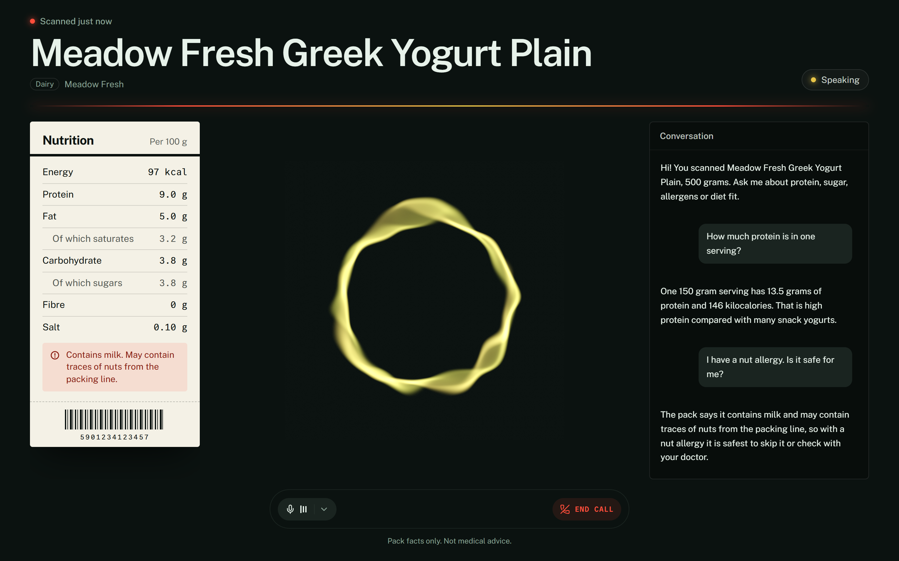
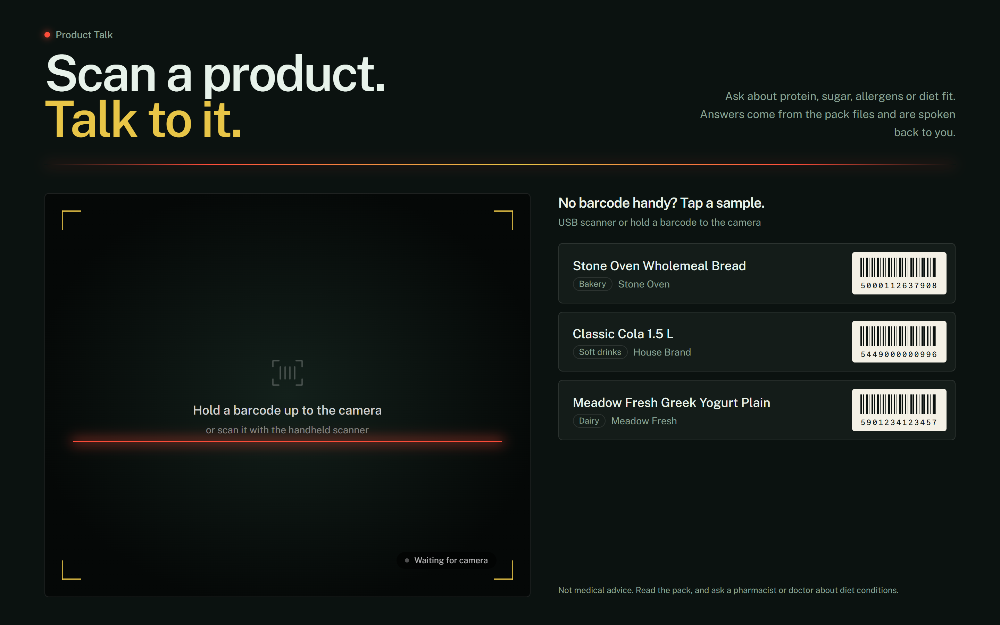
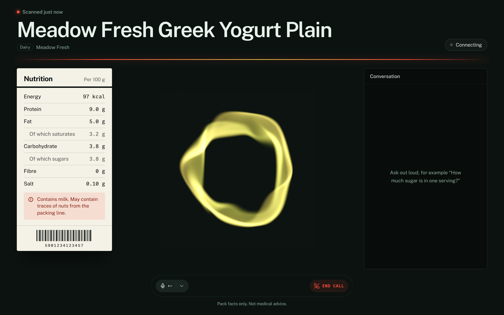
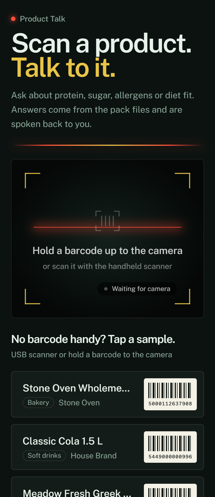
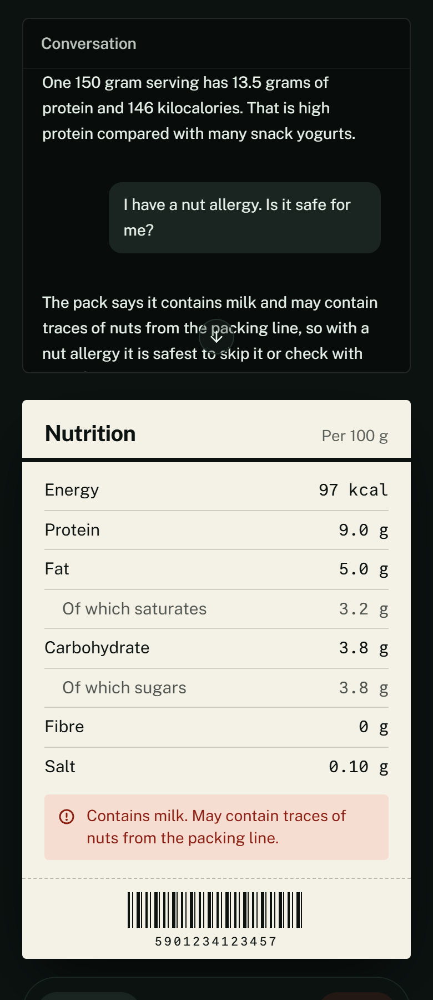
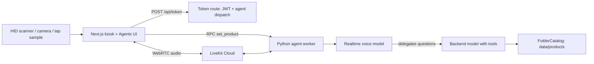

# Product Talk

**Scan a supermarket product, then ask it out loud about protein, sugar or allergens. A realtime voice agent answers from the pack facts only.**



<sub>Talking view with demo data: synthetic catalog product and a scripted stand-in agent (see [Screenshots](#screenshots)).</sub>

## Highlights

- **Voice-first kiosk.** Scan with a USB scanner or the camera, or tap a sample, and a voice session starts with that product already loaded.
- **Two-model agent.** A fast realtime speech model talks; a tool-using backend model answers nutrition and allergen questions from the pack files.
- **Grounded answers.** Tools return capped pack cards and text search over the scanned product only; no invented numbers, no medical claims.
- **Kiosk UI.** Shelf-ticket nutrition panel, live agent state, streaming transcript, responsive down to phone width.

## Why it's interesting

- **Two-model voice agent.** A realtime speech model (OpenAI GPT-Live through a LiveKit Agents worker) handles the conversation and is instructed to delegate any nutrition, allergen or diet question to a backend model that has tools and answers only from tool results ([`agent/src/agent.py`](agent/src/agent.py)). The voice model stays fast and natural; the backend model stays grounded.
- **Barcode state synced over RPC.** The kiosk reads a scan (USB HID scanner or camera), calls the worker's `set_product` RPC, and the worker loads the product, publishes `product.*` participant attributes, and silently injects the pack facts into the live session before greeting the customer.
- **Grounded, bounded answers.** Tools return compact pack cards (capped length) and text search over the scanned product's files; instructions forbid invented numbers and medical claims.
- **Swappable catalog.** `FolderCatalog` reads `data/products/{ean}/*.txt`; a vector store can replace it behind the same `get` / `search` methods without touching the tools. Barcode input is normalized so junk cannot escape the catalog directory (tested).

## Screenshots

| Idle: scan or tap a sample | Product scanned, agent joining |
|---|---|
|  |  |

| Phone width | Phone width, after a few questions |
|---|---|
|  |  |

All screenshots use demo data: the three synthetic products in `data/products/` and a scripted stand-in agent ([`scripts/demo_agent.py`](scripts/demo_agent.py)) on a local LiveKit dev server, so no API keys are involved. The stand-in plays a synthetic tone and a canned transcript copied from the yogurt's pack files; the real worker is `agent/src/agent.py`. Recapture with [`scripts/capture-screenshots.js`](scripts/capture-screenshots.js) (setup steps in its header).

## Architecture



The kiosk UI joins a LiveKit room; the token route dispatches the named agent into it. After a scan, the worker updates session state and pushes the product card to the voice model as silent context plus a greeting cue. Questions go through the tools `get_scanned_product`, `lookup_barcode` and `search_product_text`.

## Tech stack

Python 3.12, `livekit-agents`, OpenAI realtime plugin, Silero VAD, `uv`, pytest. Next.js, LiveKit Agents UI (shadcn), pnpm.

## Layout

```
agent/            Python worker (tools, RPC handler, catalog)
kiosk/            Next.js kiosk UI (based on the LiveKit agent starter, MIT)
data/products/    one folder per barcode (three synthetic samples)
docs/PROJECT.md   working notes and layout map
scripts/          screenshot capture + scripted demo agent (no LLM)
```

Sample codes: `5901234123457` yogurt, `5449000000996` cola, `5000112637908` bread.

## Getting started

Requirements: Python 3.12 + `uv`, Node + `pnpm`, a LiveKit Cloud project, an OpenAI key with GPT-Live access.

```bash
cp .env.example .env.local            # also copy to kiosk/.env.local
# fill LIVEKIT_URL, LIVEKIT_API_KEY, LIVEKIT_API_SECRET, OPENAI_API_KEY
# set ALLOW_KIOSK_TOKEN=1 in production-mode runs (see Security notes)

cd agent && uv sync && uv run python src/agent.py dev

cd kiosk && pnpm install && pnpm dev   # http://localhost:3000
```

Check the catalog without LiveKit:

```bash
cd agent && uv run python src/catalog.py --ean 5901234123457
```

## Tests

```bash
cd agent && uv run pytest tests/test_catalog.py tests/test_agent.py -q
```

Catalog tests are offline. `test_agent.py` exercises the scan state and tools.

## Security notes

- `POST /api/token` in [`kiosk/app/api/token/route.ts`](kiosk/app/api/token/route.ts) has **no authentication**: anyone who can reach the kiosk can mint a LiveKit token and dispatch the agent. It only runs in development, on Vercel previews, or when `ALLOW_KIOSK_TOKEN=1` is set. That is acceptable for a kiosk on a trusted network, not for the public internet; put an auth layer or rate limit in front before exposing it.
- The HTTPS helper (`https-proxy.mjs`) is for self-signed, in-store use.
- Never commit `.env.local`. Nutrition answers are read from pack text and are not medical advice.

## License

MIT, see [LICENSE](LICENSE). The `kiosk/` UI is derived from LiveKit's MIT-licensed starter; its own license is kept in [`kiosk/LICENSE`](kiosk/LICENSE).
